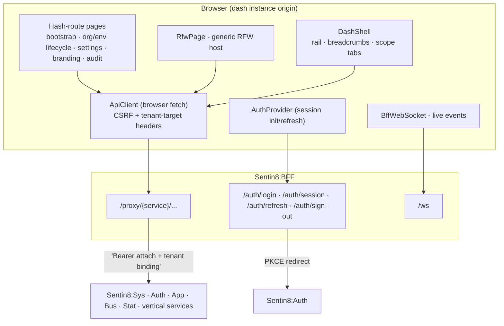

# Sentin8 Dash - Operator Dashboard (Overview)

> Audience: anyone evaluating or onboarding to the Sentin8 operator console.
> For wire-level detail read `DESIGN.md`; for the business view read
> `BUSINESS.md`.

## 1. Summary

`apps/dash` is the platform's operator and tenant-facing Flutter Web console.
It is the human front end for the platform's organization model: signing in
through Sentin8:BFF, creating and governing organizations and environments,
toggling services, editing tenant branding, auditing activity, and -
principally - hosting every service's **Remote UI (RFW) admin pages** through
a generic renderer. Dash holds zero compile-time knowledge of any vertical or
service: the navigation tree and all service admin screens arrive at runtime
from `GET /v1/verticals/services` and `GET /v1/admin/ui/{page}`, so a new
service with admin pages appears in the console without touching this code.

## 2. Motivation

- **One console for every service.** Building a native screen per service does
  not scale; the RFW contract (architecture principles §4.15) lets each
  service ship its own admin UI as data, rendered here generically.
- **Zero vertical/platform coupling in the client.** The console must render
  any registered vertical's surfaces purely from runtime metadata, keeping the
  vertical dependency direction strictly one-way (sentin8 ← verticals).
- **Tokens never in the browser.** All traffic goes through the BFF proxy with
  a session cookie - the app never holds or refreshes OAuth tokens, and every
  mutation carries CSRF and tenant-target headers.
- **Operator ergonomics.** A stable shell (collapsible rail, breadcrumbs,
  scope tabs, live navigation) so operators manage multi-org, multi-env setups
  quickly, with live updates over WebSocket.

## 3. Architecture & High-Level Design

Dash is a one-build-fits-all app: the same bundle is served for the platform
console and any org/env hostname. Its base URL is derived at runtime from
`window.location` (`https://bff.<current host>`), authentication is delegated
entirely to the BFF (`/auth/login` redirect + session cookie), and every data
call flows through `{bff}/proxy/{service}/…`.

- **Hash-routing** (`#/…`) with org/env scope in query parameters; an RFW
  catch-all route (`#/{service}/{page}`) renders any service's admin UI.
- **Client-side gating** (`RlsGuard`) is UX-only: route-level checks for
  session, org membership, env existence, and feature enablement keep the
  operator away from screens they cannot use - the backend remains the
  authorization authority.

## 4. Key Traits and Data Structures

* `AuthProvider` (singleton `ChangeNotifier`): session bootstrap
  (`GET /auth/session`), login/sign-up redirects, sign-out, scope refresh
  after org/env creation, and the single derived URL pair
  (`_sentin8Domain`, `_bffBaseUrl`) from the current hostname.
* `ApiClient` / `Sentin8Services` (`services.dart`): browser-`fetch`-based
  HTTP layer with cookie auth, CSRF header, tenant-target headers/params, one
  named client per platform service (`auth, sys, db, storage, app, bus, stat,
  func, cron, flow, log`), and a `scoped()` copy for org/env-targeted calls.
* `RfwPage` + SDK `RfwRenderer` / `RfwActions` (`rfw/rfw_page.dart`): the
  remote-UI host - loads page definitions, renders containers/tables/forms,
  executes admin actions, resolves service tabs, and host-registers native
  widgets (`policy_simulator`).
* `RlsGuard` (`rls_guard.dart`): client-side route gate resolving
  authentication → org membership → env context → feature flags, with
  targeted retry windows for identity/tls propagation delays.
* `BffWebSocket` (`bff_ws.dart`): live domain-event subscription channel with
  exponential reconnect, feeding live list updates.
* `DashShell` (`nav_shell.dart`): the persistent shell - dynamic nav tree
  from `GET /v1/verticals/services`, breadcrumbs, scope tabs, user menu.
* Design system (`theme.dart`, `theme/design_system.dart`): Royal Gold accent,
  glass panels, 4px grid, Quicksand typography; shared widgets (`ScopeSelector`,
  `RoleSelector`, `ClickableSubdomainField`, `StatusBadge`).
* Observability (`observability.dart`): correlation ids, in-memory ring-buffer
  logging, funnel metrics, alert thresholds.
* e2e bridge (`test_bridge.dart`): `window.sentin8Test*` functions that drive
  real widget code for browser automation.

## 5. Rationale, Trade-offs, and Alternatives

* **Generic RFW renderer as the primary admin surface.** One renderer serves
  every current and future service; the cost is a rich definition schema and
  data-normalization layer, repaid by eliminating per-service client work.
  Rejected alternative: hand-written admin pages per service - permanently
  coupled to every vertical (violates zero-compile-time-vertical-knowledge).
* **BFF cookie sessions over in-app token handling.** The BFF owns PKCE,
  token exchange, and transparent refresh; the client avoids all token
  lifecycle risk. Rejected alternative: Authorization-code-with-PKCE in the
  browser - tokens would live client-side.
* **Runtime URL derivation from the hostname.** One build serves every dash
  instance (`bff.{host}` is the only external URL built), matching the
  platform's dynamic domain hierarchy. Rejected alternative: build-time
  `--dart-define` endpoints - would require per-instance builds.
* **Hash routing over a router package.** Static hosting without server
  rewrite rules must serve every deep link from the same `index.html`; hash
  routes make the served file the single entry point. Trade-off: URLs carry a
  `#/` fragment. (A go_router variant exists in the codebase history but the
  hash router is the wired path.)
* **Client-side `RlsGuard` as UX only.** Guard checks rely on the same
  endpoints the operations use, with generous retries for propagation races;
  backend RLS/authorization remains the enforcement point. Rejected
  alternative: trusting client-side guards for security - rejected by design.
* **Duplicate theme tokens (`hide` SDK colors) instead of SDK theming.** Dash
  predates the shared Flutter SDK's full token set; it imports the SDK for the
  RFW machinery and hides the theme to keep its tuned look. Unified theming is
  a consolidation opportunity, not a blocker.

## 6. Internal Implementation & Invariants (Private Design)

* **Invariants:**
  - `X-BFF-Target-Env-Id` and `X-BFF-Target-Org-Id` are mutually exclusive;
    env wins whenever an env scope exists (target headers are duplicated into
    query params as a CORS-preflight-stripping workaround).
  - The BFF base URL is always `https://bff.` + current hostname - the only
    cross-host authority the app builds; no other backend is addressable.
  - Every mutating request carries `X-BFF-CSRF`.
  - RFW rendering is POST-only for mutations, per the platform renderer
    contract.
  - The nav tree and admin pages come exclusively from runtime service
    metadata - no service name is ever hardcoded into a route or widget.
  - Correlation ids ride on every request; session teardown occurs on
    authentication-family errors during bootstrap.
  - Unknown fetch failures in guard checks default to *allow*, deferring to
    backend RLS (guards are convenience, not enforcement).
* **Browser/hosting constraints honored:** CanvasKit with semantics for ARIA
  automation; `localStorage` persists only the rail-collapse preference;
  SPA fallback hosting by Sentin8:Web (`captain:app_dir:dash`).
* **Scope resolution:** `AuthProvider.refreshAndInit()` re-runs session init
  after org/env creation so the session's scopes pick up new grants.

## 7. Unresolved Questions / Future Designs

- **Dead code cluster.** A go_router-era stack (`app.dart`, `router.dart`,
  `middleware/rls_middleware.dart`), duplicate shell pages
  (`org_*`, `env_*`, `left_rail.dart`, `right_insight_panel.dart`,
  `widgets/metrics_table.dart`), and rich native app-store/instance pages are
  compiled but unreachable from the active router - consolidation (delete vs.
  promote) is pending a product decision.
- **Event transport mismatch.** `BffWebSocket` subscribes for domain events on
  `/ws`, which the BFF documentation assigns to the chat tier; the SSE
  `/subscribe` tier is the documented event channel and is not yet used by
  dash.
- **Guest browsing** ("Browse as guest") currently lands on org-picker
  endpoints that remain session-gated server-side.
- **Invite flow** (members page) has no working invite action yet.
- **User settings** destination from the shell menu is a stub.
- **Idempotency keys** are not generated client-side for mutating calls.
- **Unbranded web manifest/theme** leftovers in `web/manifest.json`
  (`#0175C2`, default names) should be aligned with the design system.
- **Environment settings theme-mode default inconsistency** (`''` dark vs
  `'light'`) between the two branding editors.

---

**Architecture & Design:** sentin8:dash and its underlying concepts were designed by [Hamid Jahanzad](https://www.linkedin.com/in/hamidjahanzad/).
